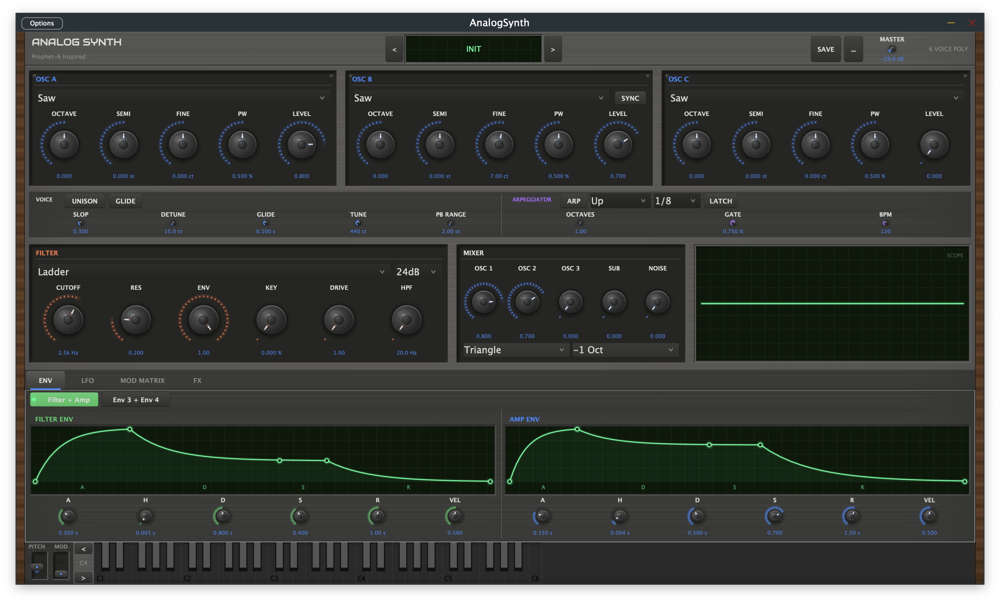

# AnalogSynth

[](LICENSE)
[](https://github.com/straplocked/analog-synth/actions/workflows/ci.yml)

Virtual analog synthesizer plugin inspired by the Sequential Prophet-6, built with JUCE 7.0.12.

**Plugin formats:** VST3, AU, Standalone



## Features

- **3 PolyBLEP oscillators** with Saw, Pulse, Triangle, Square waveforms and hard sync
- **Sub oscillator** (Sine/Triangle/Square/Pulse) and white noise generator
- **5 filter types**: Moog Ladder, Diode Ladder, Sequential SVF, TB-303 Acid, Korg MS-20
- **12dB and 24dB slopes** with drive, resonance, and key follow
- **2 ADSR envelopes** (Filter + Amp) with velocity sensitivity
- **LFO** with 5 shapes, tempo sync, and 4 modulation destinations
- **Poly Mod** (Prophet-6 style): Filter Envelope and Osc2 as modulation sources
- **Arpeggiator** with 5 modes, DAW tempo sync, octave range, gate, and latch
- **Effects chain**: Distortion, Compressor, EQ, Chorus/Flanger, Delay (ping-pong, BBD), Reverb (Room/Hall/Plate/Spring)
- **Drag-and-drop FX reordering** with eurorack-style module panels
- **Voice modes**: Poly (6 voices), Mono (legato), Unison (6-voice stack with detune and stereo spread)
- **Analog modeling**: per-voice pitch drift, phase jitter, and component tolerance variation
- **15 factory presets** with user preset save/load
- **Photorealistic UI**: brushed metal faceplate, wood end-cheeks, 3D knobs, LCD oscilloscope

## Prerequisites

- **CMake** 3.22+
- **C++17** compiler (Clang, GCC 9+, or MSVC 2019+)
- **Git** with submodule support
- **macOS**: Xcode or Command Line Tools
- **Linux**: ALSA and X11 development packages
  ```bash
  sudo apt install libasound2-dev libx11-dev libxrandr-dev libxcursor-dev libfreetype-dev libfontconfig1-dev
  ```
- **Windows**: Visual Studio 2019+ with C++ desktop workload

## Build

```bash
git clone --recurse-submodules https://github.com/analogsynth/analog-synth.git
cd analog-synth
cmake -B build
cmake --build build
```

Or with Xcode (macOS):

```bash
cmake -B build -G Xcode
open build/AnalogSynth.xcodeproj
```

Build artifacts are placed in `build/AnalogSynth_artefacts/`. On macOS, the AU and VST3 plugins are automatically copied to `~/Library/Audio/Plug-Ins/` after a successful build.

Standalone app: `build/AnalogSynth_artefacts/Debug/Standalone/AnalogSynth.app`

## Tests

```bash
cmake --build build --target AnalogSynthTests
./build/AnalogSynthTests
```

86 test cases covering all DSP and utility classes using [Catch2](https://github.com/catchorg/Catch2).

## Documentation

| Document | Audience | Description |
|----------|----------|-------------|
| [User Guide](docs/USER_GUIDE.md) | Musicians, sound designers | Complete feature reference for every synth section |
| [Architecture](docs/ARCHITECTURE.md) | Developers | Signal flow, source layout, and system design |
| [DSP Reference](docs/DSP_REFERENCE.md) | DSP developers | Algorithm details for oscillators, filters, and modulation |
| [Developer Guide](docs/DEVELOPER_GUIDE.md) | Contributors | How to add parameters, effects, filters, and UI panels |

## Contributing

See [CONTRIBUTING.md](CONTRIBUTING.md) for build instructions, coding conventions, and pull request guidelines.

## Third-Party

- **JUCE 7.0.12** — GPL-3.0 ([juce.com](https://juce.com))
- **Catch2 v3.5.2** — Boost Software License 1.0
- **Inter font** — SIL Open Font License 1.1

See [THIRD_PARTY_LICENSES.md](THIRD_PARTY_LICENSES.md) for full license texts.

## License

AnalogSynth is licensed under the [GNU General Public License v3.0](LICENSE).
